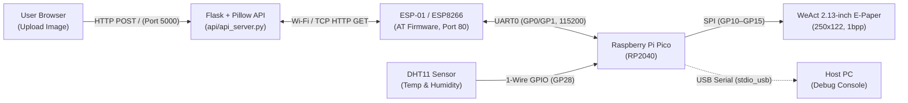

# Sentinel E-Paper IoT


-C51A4A)
-00599C)


**Sentinel E-Paper IoT** is a modular, low-power IoT display node built around the **Raspberry Pi Pico (RP2040)**. It combines local environmental sensing (**DHT11** over single-wire GPIO), Wi-Fi connectivity (**ESP-01 / ESP8266** running AT firmware over UART), a companion **Python Flask + Pillow image-processing API**, and a **WeAct 2.13" monochrome E-Paper display (`250 × 122`)** over SPI to present both a custom dithered image and live telemetry on a split-screen e-ink layout.

This project was developed as the final project for the Internet of Things (IoT) course during an academic exchange at the **Universidad Católica de Colombia** (Bogotá, Colombia).

> [!NOTE]
> **Implementation Scope:** The core firmware modules (`main.cpp`, `ESPComms`, `EPaperDriver`, `TempSensor`), `CMakeLists.txt`, and the Flask/Pillow backend (`api/api_server.py`) are implemented as a functional academic prototype. Some features—such as bitmap font rendering inside `EPaperDriver::drawInfo()`, NTP timestamp parsing in `ESPComms::getTimeAndDate()`, and full HTTP header stripping on raw `+IPD` frames—currently include simplified placeholders intended for further refinement (detailed in [Module Overview & Current Status](#module-overview--current-status)).

---

## Table of Contents

- [System Architecture](#system-architecture)
- [Split-Screen Display Layout](#split-screen-display-layout)
- [Hardware Requirements](#hardware-requirements)
- [Hardware Wiring & Pin Configuration](#hardware-wiring--pin-configuration)
- [Software Prerequisites](#software-prerequisites)
- [Getting Started](#getting-started)
- [Python Image API Reference](#python-image-api-reference)
- [Repository Structure](#repository-structure)
- [Module Overview & Current Status](#module-overview--current-status)
- [Troubleshooting & Maker Tips](#troubleshooting--maker-tips)
- [Academic Context & Credits](#academic-context--credits)

---

## System Architecture

The system divides work between the embedded **Raspberry Pi Pico** node (handling real-time hardware peripherals and AT-command orchestration) and a local **Flask + Pillow API server** (offloading image scaling, centering, Floyd–Steinberg dithering, and 1-bit monochrome byte packing):



### Runtime Control Flow (`src/main.cpp`)

1. **System Boot (`initialize_system`):** Initializes USB/UART stdio (with a 2 s startup delay), resets and clears the WeAct E-Paper screen, configures the DHT11 GPIO pin with an internal pull-up, initializes `uart0` at `115200` baud, connects the ESP8266 to Wi-Fi via AT commands (`AT+RST` → `AT+CWMODE=1` → `AT+CWJAP` → `AT+CIFSR`), and opens a multi-connection TCP server on port `80` (`AT+CIPMUX=1`, `AT+CIPSERVER=1,80`).
2. **Initial Image Fetch (`get_image_from_server`):** Opens a TCP connection (`AT+CIPSTART`) to the local Flask API (`<PC_IP>:5000`), sends an `HTTP GET /`, reads the incoming binary image buffer into `image_half_buffer`, and loads it into `EPaperDriver::setImageBuffer()`.
3. **Dual Update Loop (`main`):**
   - **Time-Based Refresh (Every 60 s):** Reads temperature and humidity from the DHT11 (`TempSensor::readData()`), retrieves the timestamp (`ESPComms::getTimeAndDate()`), updates the right-half telemetry (`EPaperDriver::drawInfo()`), refreshes the E-Paper panel (`EPaperDriver::updateDisplay()`), and requests an updated image from the API.
   - **Event-Based Refresh (Port 80 Trigger):** Polls `ESPComms::handleWebServerRequest()` for incoming `+IPD` HTTP traffic on the ESP8266's IP address. When a client connects, the Pico closes connection `0` (`AT+CIPCLOSE=0`), fetches the latest image buffer, and refreshes the screen.

---

## Split-Screen Display Layout

The **WeAct 2.13" (`250 × 122`, 1bpp)** framebuffer (`EPAPER_SIZE = 3,812 bytes`) is logically split vertically at `RIGHT_START_X = 125`:

```text
+-----------------------------+-----------------------------+
|                             |  Temp: 24 C                 |
|      1-bit Monochrome       |                             |
|       Uploaded Image        |  10/11/2025 15:43           |
|        (125 x 122 px)       |                             |
|       ~1,906 bytes          |  IP: 192.168.x.x            |
+-----------------------------+-----------------------------+
x = 0                       x = 125                       x = 249
```

- **Left Half (`0–124`, `125 × 122` px):** Displays the 1-bit dithered monochrome image generated by `api/api_server.py`.
- **Right Half (`125–249`, `125 × 122` px):** Displays ambient temperature (`°C` from DHT11, falling back to `99.9°C` on read failure), date/time, and the node's local Wi-Fi IP address.

---

## Hardware Requirements

To replicate this project, you will need the following components:

| Component | Interface | Role | Notes |
| :--- | :--- | :--- | :--- |
| **Raspberry Pi Pico (RP2040)** | USB / SPI / UART / GPIO | Main microcontroller | Runs C/C++17 firmware built with the Pico SDK (`SentinelEpaper.uf2`) |
| **WeAct 2.13" E-Paper Display** | SPI (`4 MHz`) | Low-power display | `250 × 122` monochrome (1bpp), 3.3V logic |
| **DHT11 Sensor Module** | 1-Wire Digital GPIO | Temperature & humidity sensing | 3.3V logic; custom microsecond bit-banging driver on `GP28` |
| **ESP-01 / ESP8266 Module** | UART (`115200` baud) | Wi-Fi connectivity & TCP server | 3.3V logic; requires **AT command firmware** |
| **3.3V Power Supply (Recommended)** | Power | Dedicated supply for ESP8266 | Wi-Fi TX current spikes (~250–300 mA) can cause brownouts if drawn directly from the Pico |
| **Micro-USB Data Cable** | USB | Flashing (`.uf2`) & serial debugging | Must support data transfer (not charge-only) |
| **Breadboard & Jumper Wires** | — | Prototyping & interconnections | Share a common `GND` across all modules |

> [!WARNING]
> All components in this build (**Raspberry Pi Pico**, **WeAct 2.13" E-Paper**, **DHT11**, and **ESP-01 / ESP8266**) operate at **3.3V logic**. Do **not** apply 5V directly to RP2040 or ESP8266 GPIO, SPI, or UART pins.

---

## Hardware Wiring & Pin Configuration

All GPIO assignments, display dimensions, UART settings, and Wi-Fi credentials are centralized in [`src/modules/utils/Config.h`](src/modules/utils/Config.h).

### 1. WeAct 2.13" E-Paper Display (SPI)

| E-Paper Pin | Function | `Config.h` Macro | Pico GPIO | Physical Pin |
| :--- | :--- | :--- | :--- | :--- |
| `VCC` | Power (3.3V) | — | `3V3` | Pin 36 (`3V3 OUT`) |
| `GND` | Ground | — | `GND` | Any `GND` pin |
| `SCL` / `SCK` | SPI Clock | `EPAPER_SCK_PIN` | `GP10` | Pin 14 |
| `SDA` / `MOSI` | SPI Data In | `EPAPER_MOSI_PIN` | `GP11` | Pin 15 |
| `CS` | Chip Select | `EPAPER_CS_PIN` | `GP12` | Pin 16 |
| `DC` | Data / Command | `EPAPER_DC_PIN` | `GP13` | Pin 17 |
| `RES` / `RST` | Hardware Reset | `EPAPER_RST_PIN` | `GP14` | Pin 19 |
| `BUSY` | Busy Status Input | `EPAPER_BUSY_PIN` | `GP15` | Pin 20 |

> [!IMPORTANT]
> On the RP2040 pinout, `GP10` (`SCK`) and `GP11` (`TX/MOSI`) are routed to hardware **`spi1`**, whereas [`src/modules/e_paper/EPaperDriver.cpp`](src/modules/e_paper/EPaperDriver.cpp) currently defines `#define EPAPER_SPI_ID spi0`. When wiring real hardware, either switch `EPAPER_SPI_ID` to `spi1` or remap `EPAPER_SCK_PIN` / `EPAPER_MOSI_PIN` to valid `spi0` pins (e.g., `GP2`/`GP3`, `GP6`/`GP7`, or `GP18`/`GP19`).

### 2. DHT11 Environmental Sensor (1-Wire GPIO)

| DHT11 Pin | Function | `Config.h` Macro | Pico GPIO | Physical Pin |
| :--- | :--- | :--- | :--- | :--- |
| `VCC` | Power (3.3V) | — | `3V3` | Pin 36 (`3V3 OUT`) |
| `GND` | Ground | — | `GND` | Any `GND` pin |
| `DATA` | 1-Wire Data Line | `DHT11_DATA_PIN` | `GP28` | Pin 34 |

*Note: `TempSensor::init()` enables the RP2040's internal pull-up resistor on `GP28`. If you are using a bare 4-pin DHT11 (without a breakout PCB), adding an external `4.7 kΩ–10 kΩ` pull-up resistor between `DATA` and `3V3` improves signal reliability.*

### 3. ESP-01 / ESP8266 Module (`uart0` @ `115200` baud)

| ESP-01 Pin | Function | `Config.h` Macro | Pico GPIO | Physical Pin |
| :--- | :--- | :--- | :--- | :--- |
| `VCC` | Power (3.3V) | — | External 3.3V regulator | Regulated 3.3V (`>= 500 mA`) |
| `GND` | Common Ground | — | `GND` | Common `GND` with Pico |
| `CH_PD` / `EN` | Chip Enable | — | `3V3` | Pull HIGH to `3.3V` |
| `RX` | ESP Receive | `ESP_TX_PIN` | `GP0` (`UART0 TX`) | Pin 1 |
| `TX` | ESP Transmit | `ESP_RX_PIN` | `GP1` (`UART0 RX`) | Pin 2 |

> [!TIP]
> [`CMakeLists.txt`](CMakeLists.txt) currently enables both USB stdio (`pico_enable_stdio_usb 1`) and UART stdio (`pico_enable_stdio_uart 1`). Because `uart0` (`GP0`/`GP1`) is connected to the ESP8266, **disable UART stdio (`pico_enable_stdio_uart(${PROJECT_NAME} 0)`)** if you notice `printf` debug messages interfering with AT commands sent to the ESP8266. That keeps `printf` output strictly on USB while dedicating `uart0` to the Wi-Fi module.

---

## Software Prerequisites

### Firmware Toolchain (Raspberry Pi Pico)

- **CMake** `>= 3.13`
- **ARM GNU Toolchain** (`arm-none-eabi-gcc`, `arm-none-eabi-g++`)
- **Build system:** `ninja` or `make`
- **Raspberry Pi Pico C/C++ SDK:** [raspberrypi/pico-sdk](https://github.com/raspberrypi/pico-sdk) with the `PICO_SDK_PATH` environment variable set
- **Git**

On **Ubuntu / Debian**, install the base toolchain with:

```bash
sudo apt update
sudo apt install cmake ninja-build gcc-arm-none-eabi libnewlib-arm-none-eabi build-essential git
```

Clone the Pico SDK and export `PICO_SDK_PATH`:

```bash
git clone --recurse-submodules https://github.com/raspberrypi/pico-sdk.git ~/pico-sdk
export PICO_SDK_PATH=~/pico-sdk
```

> [!TIP]
> On **Windows** or **macOS**, the quickest setup is the official [Raspberry Pi Pico VS Code Extension](https://marketplace.visualstudio.com/items?itemName=raspberry-pi.raspberry-pi-pico), which configures the ARM toolchain, CMake, Ninja, and `PICO_SDK_PATH` automatically.

### Backend API Toolchain

- **Python** `3.9+` and `pip`
- Dependencies pinned in [`api/requirements.txt`](api/requirements.txt): `Flask` and `Pillow`

---

## Getting Started

### 1. Clone the Repository

```bash
git clone https://github.com/Tonycode-MX/Sentinel_Epaper_IoT.git
cd Sentinel_Epaper_IoT
```

### 2. Configure Wi-Fi Credentials & API Server IP

1. Open [`src/modules/utils/Config.h`](src/modules/utils/Config.h) and set your network credentials:

   ```cpp
   #define WIFI_SSID           "YOUR_SSID"
   #define WIFI_PASSWORD       "PASSWORD"
   ```

2. Open [`src/main.cpp`](src/main.cpp) (`get_image_from_server()`) and update `api_host` to the local IP address of the machine running the Flask API:

   ```cpp
   const char* api_host = "192.168.1.73"; // Replace with your host PC's LAN IP
   const int api_port = 5000;
   ```

> [!WARNING]
> Never commit real Wi-Fi credentials to a public repository. Keep placeholder values in `Config.h` when pushing changes to GitHub.

### 3. Build the Pico Firmware (`.uf2`)

```bash
mkdir -p build
cd build
cmake ..
cmake --build .
```

When compilation finishes, CMake generates the flashable binary:

```text
build/SentinelEpaper.uf2
```

### 4. Flash the Firmware to the Raspberry Pi Pico

1. Disconnect the Raspberry Pi Pico from your computer.
2. Press and **hold** the white **`BOOTSEL`** button on the Pico.
3. Connect the Pico via USB, then release **`BOOTSEL`**.
4. A USB mass-storage volume named **`RPI-RP2`** will mount.
5. Copy `build/SentinelEpaper.uf2` onto `RPI-RP2`. The Pico will reboot automatically and start executing the firmware.

### 5. Monitor Serial Debug Logs (USB)

Connect to the Pico's USB CDC serial port to observe initialization logs, DHT11 readings, and AT-command traffic:

```bash
# Example on Linux (device name may vary, e.g., /dev/ttyACM0)
picocom -b 115200 /dev/ttyACM0
```

### 6. Start the Python Image API

```bash
cd api
python3 -m venv .venv
source .venv/bin/activate       # On Windows: .venv\Scripts\activate
pip install -r requirements.txt
python api_server.py
```

The server listens on **`http://0.0.0.0:5000`**.

---

## Python Image API Reference

[`api/api_server.py`](api/api_server.py) provides a lightweight web interface and binary conversion pipeline tailored to the left half (`125 × 122`) of the WeAct E-Paper screen:

| Method & Route | Description | Request / Response |
| :--- | :--- | :--- |
| `GET /` | Serves a minimal HTML upload form | Returns HTML form (`multipart/form-data`, input name `file`) |
| `POST /` | Converts an uploaded image into a 1-bit E-Paper bitmap | Accepts `file` upload; returns `image_buffer.bin` (`application/octet-stream`) |

### Image Conversion Pipeline

1. **Aspect-Ratio Scaling:** Uses `Image.thumbnail((125, 122))` to resize the uploaded image without distortion.
2. **Centering:** Pastes the scaled image onto a `125 × 122` 8-bit grayscale (`L`) white (`255`) canvas.
3. **1-Bit Dithering:** Converts to 1-bit monochrome (`mode '1'`) using **Floyd–Steinberg dithering** (`Image.FLOYDSTEINBERG`).
4. **Raw Byte Packing:** Scans row-by-row (`IMG_HEIGHT = 122`, `IMG_WIDTH // 8 = 15` full bytes per row), packing 8 pixels per byte MSB-first (`bit = 1` for black pixels `< 128`, `0` for white).

> [!NOTE]
> Because `IMG_WIDTH = 125` is not divisible by 8 (`125 // 8 = 15` bytes/row → `15 × 122 = 1,830` bytes), the loop in `api_server.py` produces `1,830` bytes while `OUTPUT_SIZE_BYTES = (125 * 122) // 8` expects `1,906` bytes. Padding the row width to a multiple of 8 (e.g., `128 px` / `16` bytes per row) aligns both the Python encoder and the C++ framebuffer cleanly.

---

## Repository Structure

```text
Sentinel_Epaper_IoT/
│
├── api/
│   ├── api_server.py               # Flask + Pillow server: image upload, 1bpp dithering, raw byte export
│   └── requirements.txt            # Python dependencies (Flask, Pillow)
│
├── build/
│   └── .gitkeep                    # Build directory placeholder (compiled artifacts should be gitignored)
│
├── src/
│   ├── modules/
│   │   ├── comms/
│   │   │   ├── ESPComms.cpp        # UART0 driver, AT command runner, Wi-Fi join, TCP server & buffer RX
│   │   │   └── ESPComms.h          # ESPComms class declaration
│   │   ├── e_paper/
│   │   │   ├── EPaperDriver.cpp    # SPI driver for WeAct 2.13" (250x122): init, clear, buffer write, sleep
│   │   │   └── EPaperDriver.h      # EPaperDriver class declaration & 3,812-byte framebuffer
│   │   ├── sensors/
│   │   │   ├── TempSensor.cpp      # 1-Wire DHT11 bit-banging driver on GP28 with checksum verification
│   │   │   └── TempSensor.h        # TempSensor class & DHTData struct (temperature_c, humidity, valid)
│   │   └── utils/
│   │       ├── Config.h            # Centralized GPIO pins, display dimensions, UART baud, Wi-Fi defines
│   │       ├── ImageParser.cpp     # Standalone image buffer size validation utility
│   │       └── ImageParser.h       # ImageParser class declaration
│   │
│   └── main.cpp                    # System startup, 60 s refresh loop, HTTP API fetch & port-80 trigger
│
├── .gitattributes                  # Git line-ending / attribute rules
├── .gitignore                      # Ignored build artifacts & virtual environments
├── CMakeLists.txt                  # Pico SDK build config (target: SentinelEpaper.uf2)
└── README.md                       # Project documentation, wiring, and usage guide
```

---

## Module Overview & Current Status

| Component / File | Responsibility | Implementation Status |
| :--- | :--- | :--- |
| [`CMakeLists.txt`](CMakeLists.txt) | Builds `SentinelEpaper.uf2` (C11/C++17); links `pico_stdlib`, `hardware_spi`, `hardware_uart`, `hardware_gpio` | Implemented |
| [`src/modules/utils/Config.h`](src/modules/utils/Config.h) | Centralizes E-Paper SPI pins (`GP10–GP15`), UART0 pins (`GP0/GP1`), DHT11 pin (`GP28`), `250 × 122` layout, and Wi-Fi macros | Implemented |
| [`src/modules/sensors/TempSensor.*`](src/modules/sensors/TempSensor.cpp) | Full DHT11 1-wire handshake (`20 ms` start pulse, `80 µs` response, 40-bit timing decode, 8-bit checksum) | Implemented |
| [`src/modules/comms/ESPComms.*`](src/modules/comms/ESPComms.cpp) | `uart0` init, AT command helper, Wi-Fi join + `AT+CIFSR` IP parsing, TCP port-80 server, `+IPD` polling, raw RX | Prototype (`getTimeAndDate()` returns placeholder; add `handleWebServerRequest()` declaration to `ESPComms.h`) |
| [`src/modules/e_paper/EPaperDriver.*`](src/modules/e_paper/EPaperDriver.cpp) | SPI init (`4 MHz`), reset, BUSY polling, `clearScreen()`, `setImageBuffer()`, `updateDisplay()`, `sleep()` | Prototype (`drawInfo()` logs to serial; font bitmap table & `drawText`/`drawChar` pending) |
| [`src/modules/utils/ImageParser.*`](src/modules/utils/ImageParser.cpp) | Validates incoming image buffer length against expected framebuffer size | Standalone utility (not yet linked in `CMakeLists.txt`) |
| [`src/main.cpp`](src/main.cpp) | Boot sequence, TCP `GET /` image pull from Flask API, 60 s periodic loop, and port-80 refresh trigger | Implemented |
| [`api/api_server.py`](api/api_server.py) & [`api/requirements.txt`](api/requirements.txt) | Flask upload form + Pillow resize, center, Floyd–Steinberg 1bpp dither, and binary stream response | Implemented |

---

## Troubleshooting & Maker Tips

- **ESP-01 reboots or fails `AT+CWJAP`:** The Pico's onboard `3V3` regulator may dip during ESP8266 Wi-Fi TX bursts. Power the ESP-01 from a dedicated `3.3V` regulator (`>= 500 mA`) and tie all `GND` lines together.
- **No response to AT commands on `uart0`:**
  - Verify crossed wiring: Pico `GP0` (`TX`) → ESP `RX`, and Pico `GP1` (`RX`) → ESP `TX`.
  - Confirm `CH_PD` (`EN`) is tied HIGH to `3.3V` and the ESP-01 is flashed with `115200`-baud AT firmware.
  - Set `pico_enable_stdio_uart(${PROJECT_NAME} 0)` in [`CMakeLists.txt`](CMakeLists.txt) so debug `printf` logs do not collide with AT commands on `uart0`.
- **E-Paper does not respond over SPI:** Check the `spi0` vs. `spi1` mapping on `GP10`/`GP11` (see the note in [Hardware Wiring & Pin Configuration](#1-weact-213-e-paper-display-spi)) and confirm your WeAct panel's controller IC datasheet (typically SSD1680) matches the initialization commands in `EPaperDriver.cpp`.
- **DHT11 checksum errors or timeouts:** Keep jumper wires short, ensure a stable `3.3V` supply, and avoid polling the DHT11 faster than once every 1–2 seconds (the main loop polls every 60 seconds, which is well within spec).
- **Pico cannot reach the Flask API (`AT+CIPSTART` fails):** Confirm both the ESP8266 and your PC are on the same LAN, update `api_host` in [`src/main.cpp`](src/main.cpp), and allow incoming TCP traffic on port `5000` in your host firewall.
- **`RPI-RP2` drive does not mount:** Use a **data-capable** Micro-USB cable and hold `BOOTSEL` *before* plugging the Pico into your computer.

---

## Academic Context & Credits

- **Author:** [Tonycode-MX](https://github.com/Tonycode-MX)
- **Institution:** Developed for the Internet of Things (IoT) final course project during an academic exchange at **Universidad Católica de Colombia** (Bogotá, Colombia).
