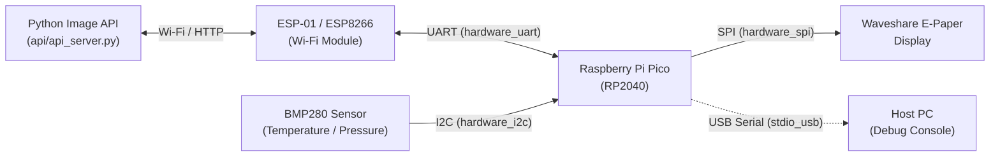

# Sentinel E-Paper IoT


-C51A4A)
-00599C)


**Sentinel E-Paper IoT** is a modular, low-power IoT display node built around the **Raspberry Pi Pico (RP2040)**. It combines local environmental sensing (**BMP280** over I2C), Wi-Fi connectivity (**ESP-01 / ESP8266** over UART), an external **Python image-processing API**, and a **Waveshare E-Paper display** (SPI) to fetch, parse, and render visual information and sensor readings on an electronic ink screen.

This project was developed for the final project of the IoT course as part of my academic exchange at the **Universidad Católica de Colombia** (Bogotá, Colombia).

> [!NOTE]
> **Current Project Status (Work in Progress):** This repository currently holds the complete project architecture, modular file scaffolding, and initial `CMakeLists.txt` build configuration. The firmware modules in `src/` and the backend service in `api/` are currently empty placeholders ready for implementation. Hardware pinouts and API endpoints below include editable placeholders so you can follow along or adapt the project to your own setup.

---

## Table of Contents

- [System Architecture](#system-architecture)
- [Hardware Requirements](#hardware-requirements)
- [Hardware Wiring & Pin Configuration](#hardware-wiring--pin-configuration)
- [Software Prerequisites](#software-prerequisites)
- [Getting Started](#getting-started)
- [Repository Structure](#repository-structure)
- [Module Overview & Roadmap](#module-overview--roadmap)
- [Troubleshooting & Maker Tips](#troubleshooting--maker-tips)
- [Academic Context & Credits](#academic-context--credits)

---

## System Architecture

The system splits responsibilities between an embedded **Raspberry Pi Pico** node (handling real-time hardware peripherals) and a lightweight **Python API server** (offloading heavy image resizing, dithering, and monochrome/color bitmap conversion):



### How the Pieces Work Together

1. **Sensing (`TempSensor`):** The Pico reads ambient temperature (and optionally barometric pressure) from the **BMP280** over I2C.
2. **Connectivity (`ESPComms`):** The Pico exchanges commands, sensor payloads, and image buffers with the **ESP-01 / ESP8266** over hardware UART (USB is reserved exclusively for serial debugging).
3. **Image Processing (`api_server.py` & `ImageParser`):** The external Python API converts source images into compact E-Paper-compatible byte arrays; `ImageParser` decodes and maps incoming buffers on the Pico.
4. **Rendering (`EPaperDriver`):** The Pico drives the **Waveshare E-Paper** panel over SPI to refresh the screen while keeping power consumption minimal between updates.

---

## Hardware Requirements

To replicate this project, you will need the following components:

| Component | Interface | Role | Notes |
| :--- | :--- | :--- | :--- |
| **Raspberry Pi Pico (RP2040)** | USB / SPI / I2C / UART | Main microcontroller | Runs C/C++ firmware built with the Pico SDK (`.uf2`) |
| **Waveshare E-Paper Display** | SPI | Low-power display | 3.3V logic; model/resolution configured in `Config.h` |
| **BMP280 Sensor Module** | I2C | Temperature & pressure sensing | 3.3V logic; typical I2C address `0x76` or `0x77` |
| **ESP-01 / ESP8266 Module** | UART | Wi-Fi connectivity | 3.3V logic; AT firmware or custom bridge firmware |
| **3.3V Power Supply (Recommended)** | Power | Dedicated supply for ESP-01 | ESP8266 Wi-Fi spikes (~250–300 mA) can reset the Pico if powered weakly |
| **Micro-USB Data Cable** | USB | Flashing (`.uf2`) & serial debugging | Must support data transfer (not charge-only) |
| **Breadboard & Jumper Wires** | — | Prototyping & interconnections | Female-to-male / male-to-male as needed |

> [!WARNING]
> All components in this build (**Raspberry Pi Pico**, **Waveshare E-Paper**, **BMP280**, and **ESP-01 / ESP8266**) operate at **3.3V logic**. Do **not** connect 5V signals directly to their GPIO, I2C, SPI, or UART pins.

---

## Hardware Wiring & Pin Configuration

All GPIO assignments, bus instances, I2C addresses, and baud rates are designed to be centralized in [`src/modules/utils/Config.h`](src/modules/utils/Config.h). Because the firmware is still in progress, the tables below provide **configurable placeholders** alongside common default Raspberry Pi Pico pin suggestions.

### 1. Waveshare E-Paper Display (SPI)

| E-Paper Pin | Function | Pico Pin (`Config.h`) | Suggested Pico Default (`spi0`) |
| :--- | :--- | :--- | :--- |
| `VCC` | Power (3.3V) | `3V3` | Pin 36 (`3V3 OUT`) |
| `GND` | Ground | `GND` | Any `GND` pin |
| `DIN` | SPI MOSI | `EPD_MOSI_PIN` *(TBD)* | `GP19` (or `GP3` / `GP7`) |
| `CLK` | SPI SCK | `EPD_SCK_PIN` *(TBD)* | `GP18` (or `GP2` / `GP6`) |
| `CS` | Chip Select | `EPD_CS_PIN` *(TBD)* | `GP17` |
| `DC` | Data / Command | `EPD_DC_PIN` *(TBD)* | `GP20` |
| `RST` | Hardware Reset | `EPD_RST_PIN` *(TBD)* | `GP21` |
| `BUSY` | Busy Status Input | `EPD_BUSY_PIN` *(TBD)* | `GP22` |

### 2. BMP280 Sensor (I2C)

| BMP280 Pin | Function | Pico Pin (`Config.h`) | Suggested Pico Default (`i2c0`) |
| :--- | :--- | :--- | :--- |
| `VCC` | Power (3.3V) | `3V3` | Pin 36 (`3V3 OUT`) |
| `GND` | Ground | `GND` | Any `GND` pin |
| `SDA` | I2C Data | `BMP_SDA_PIN` *(TBD)* | `GP4` |
| `SCL` | I2C Clock | `BMP_SCL_PIN` *(TBD)* | `GP5` |

*Default I2C address placeholder:* `0x76` (when `SDO` is tied to `GND`) or `0x77` (when `SDO` is tied to `3V3`).

### 3. ESP-01 / ESP8266 Module (UART)

| ESP-01 Pin | Function | Pico Pin (`Config.h`) | Suggested Pico Default (`uart0`) |
| :--- | :--- | :--- | :--- |
| `VCC` | Power (3.3V) | External 3.3V regulator | Regulated 3.3V (>= 500 mA) |
| `GND` | Common Ground | `GND` | Share common `GND` with Pico |
| `CH_PD` / `EN` | Chip Enable | `3V3` | Pull HIGH to 3.3V |
| `TX` | ESP Transmit | `ESP_RX_PIN` *(TBD)* | `GP1` (`UART0 RX`) |
| `RX` | ESP Receive | `ESP_TX_PIN` *(TBD)* | `GP0` (`UART0 TX`) |

> [!TIP]
> In [`CMakeLists.txt`](CMakeLists.txt), standard I/O over USB is **enabled** (`pico_enable_stdio_usb 1`) and standard I/O over UART is **disabled** (`pico_enable_stdio_uart 0`). This keeps the hardware UART bus dedicated to the ESP-01 while allowing you to read `printf` debug logs cleanly over USB.

---

## Software Prerequisites

### Firmware Toolchain (Raspberry Pi Pico)

- **CMake** `>= 3.13`
- **ARM GNU Toolchain** (`arm-none-eabi-gcc`, `arm-none-eabi-g++`)
- **Build system:** `make` or `ninja`
- **Raspberry Pi Pico C/C++ SDK:** [raspberrypi/pico-sdk](https://github.com/raspberrypi/pico-sdk) with the `PICO_SDK_PATH` environment variable configured
- **Git**

On **Ubuntu / Debian**, you can install the base toolchain with:

```bash
sudo apt update
sudo apt install cmake gcc-arm-none-eabi libnewlib-arm-none-eabi build-essential git
```

Then clone the Pico SDK and export its path:

```bash
git clone --recurse-submodules https://github.com/raspberrypi/pico-sdk.git ~/pico-sdk
export PICO_SDK_PATH=~/pico-sdk
```

> On **Windows** or **macOS**, the easiest setup method is the official [Raspberry Pi Pico VS Code Extension](https://marketplace.visualstudio.com/items?itemName=raspberry-pi.raspberry-pi-pico) or the official Pico SDK Getting Started guide.

### Backend API Toolchain

- **Python** `3.9+` and `pip`
- Expected libraries (to be pinned in [`api/requirements.txt`](api/requirements.txt)): e.g., `Flask` (or `FastAPI`) and `Pillow` for image transformation.

---

## Getting Started

### 1. Clone the Repository

```bash
git clone https://github.com/Tonycode-MX/Sentinel_Epaper_IoT.git
cd Sentinel_Epaper_IoT
```

### 2. Configure Pins & Parameters

Once implemented, adjust hardware pins, sensor addresses, UART baud rate, Wi-Fi credentials, and the API server URL in:

```text
src/modules/utils/Config.h
```

### 3. Build the Pico Firmware (`.uf2`)

> [!IMPORTANT]
> Right now, the source files in `src/` are empty scaffolding files, so compilation will succeed only once `main.cpp` and the module implementations are written. Additionally, verify that `pico_sdk_import.cmake` from your Pico SDK (`$PICO_SDK_PATH/external/pico_sdk_import.cmake`) is available and referenced appropriately in [`CMakeLists.txt`](CMakeLists.txt) before running CMake.

```bash
cd build
cmake ..
make -j$(nproc)
```

When the build completes, CMake generates the flashable binary:

```text
build/Sentinel_Epaper_IoT.uf2
```

### 4. Flash the Firmware to the Raspberry Pi Pico

1. Disconnect the Raspberry Pi Pico from your computer.
2. Press and **hold** the white **`BOOTSEL`** button on the Pico.
3. Plug the Pico into your computer via USB, then release **`BOOTSEL`**.
4. A USB mass-storage drive named **`RPI-RP2`** will appear.
5. Drag and drop `build/Sentinel_Epaper_IoT.uf2` onto the `RPI-RP2` drive. The Pico will automatically reboot and start running the firmware.

### 5. View Serial Debug Logs (USB)

Because USB stdio is enabled in `CMakeLists.txt`, you can monitor runtime logs using any serial terminal (such as `minicom`, `picocom`, `screen`, PuTTY, or the VS Code Serial Monitor):

```bash
# Example on Linux (device name may vary, e.g., /dev/ttyACM0)
picocom -b 115200 /dev/ttyACM0
```

### 6. Set Up and Run the Python Image API

```bash
cd api
python3 -m venv .venv
source .venv/bin/activate       # On Windows: .venv\Scripts\activate
pip install -r requirements.txt
python api_server.py
```

*(API endpoints, request/response formats, and bitmap encoding parameters will be documented here once `api/api_server.py` is implemented.)*

---

## Repository Structure

```text
Sentinel_Epaper_IoT/
│
├── api/
│   ├── api_server.py               # External Python API for image transformation & serving
│   └── requirements.txt            # Python API dependencies (e.g., Flask, Pillow)
│
├── build/
│   └── .gitkeep                    # Keeps the build/ output directory tracked in Git (ignore compiled artifacts)
│
├── src/
│   ├── modules/
│   │   ├── comms/
│   │   │   ├── ESPComms.cpp        # UART send/receive logic and ESP-01/ESP8266 protocol handling
│   │   │   └── ESPComms.h          # UART communication interface for the ESP8266
│   │   ├── e_paper/
│   │   │   ├── EPaperDriver.cpp    # SPI driver and drawing routines for the Waveshare E-Paper display
│   │   │   └── EPaperDriver.h      # E-Paper driver interface and command definitions
│   │   ├── sensors/
│   │   │   ├── TempSensor.cpp      # I2C reading logic and temperature conversion for the BMP280
│   │   │   └── TempSensor.h        # Temperature sensor abstraction interface
│   │   └── utils/
│   │       ├── Config.h            # Centralized pin definitions, I2C addresses, baud rates, and constants
│   │       ├── ImageParser.cpp     # Image buffer decoding and bit-mapping logic for E-Paper frames
│   │       └── ImageParser.h       # Image parser interface and buffer management
│   │
│   └── main.cpp                    # Main application loop and system control flow
│
├── .gitattributes                  # Git attribute settings (e.g., line-ending normalization)
├── .gitignore                      # Untracked files/folders to ignore (e.g., compiled binaries in build/)
├── CMakeLists.txt                  # Main Pico SDK CMake build configuration (.uf2 target)
└── README.md                       # Project documentation, setup instructions, and usage guide
```

---

## Module Overview & Roadmap

| Component / File | Purpose | Current Status |
| :--- | :--- | :--- |
| `CMakeLists.txt` | Pico SDK build target (`Sentinel_Epaper_IoT.uf2`), links `pico_stdlib`, `hardware_spi`, `hardware_i2c`, `hardware_uart` | Configured (initial setup) |
| `src/modules/utils/Config.h` | Pinout, I2C address, UART settings, display dimensions, network config | Scaffolded (placeholder) |
| `src/modules/sensors/TempSensor.*` | BMP280 initialization and temperature readout over I2C | Scaffolded (placeholder) |
| `src/modules/e_paper/EPaperDriver.*` | Waveshare E-Paper SPI init, buffer write, refresh, and sleep commands | Scaffolded (placeholder) |
| `src/modules/comms/ESPComms.*` | UART communication with ESP-01 / ESP8266 (Wi-Fi & HTTP requests) | Scaffolded (placeholder) |
| `src/modules/utils/ImageParser.*` | Parse incoming API image payloads into display-ready bitmaps | Scaffolded (placeholder) |
| `src/main.cpp` | System initialization and main control loop | Scaffolded (placeholder) |
| `api/api_server.py` & `requirements.txt` | Image resizing/dithering API serving bitmaps to the IoT node | Scaffolded (placeholder) |
| `.gitignore` & `.gitattributes` | Repository hygiene and line-ending rules | Scaffolded (placeholder) |

---

## Troubleshooting & Maker Tips

- **ESP-01 keeps rebooting or dropping Wi-Fi:** The Pico's onboard `3V3` regulator may struggle with ESP8266 transmit spikes. Use a dedicated 3.3V regulator (e.g., AMS1117-3.3 or buck converter) and tie all `GND` lines together.
- **No UART response from ESP-01:** Double-check that `TX` connects to `RX` and `RX` connects to `TX`, ensure `CH_PD` (`EN`) is pulled HIGH to `3.3V`, and verify matching baud rates (commonly `115200` for stock AT firmware).
- **BMP280 not detected on I2C:** Verify pull-up resistors (most breakout boards include them) and check both standard I2C addresses: `0x76` and `0x77`.
- **`RPI-RP2` drive does not appear when plugging in the Pico:** Make sure you are using a **data-capable** Micro-USB cable and holding `BOOTSEL` *before* connecting USB.
- **E-Paper lifespan & ghosting:** E-Paper panels are designed for infrequent updates (seconds to minutes apart). Always put the panel into deep sleep between refreshes once implemented.

---

## Academic Context & Credits

- **Author:** [Tonycode-MX](https://github.com/Tonycode-MX)
- **Institution:** Developed for the Internet of Things (IoT) final course project during an academic exchange at **Universidad Católica de Colombia** (Bogotá, Colombia).
